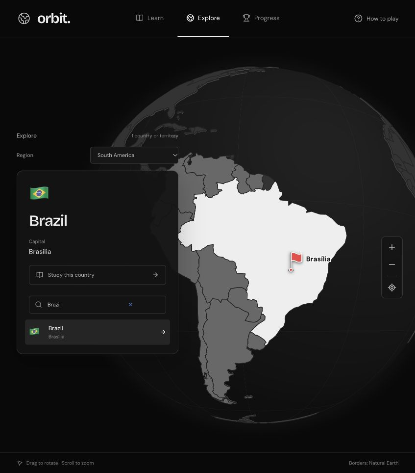

# Orbit

A 3D geography game built with React. Learn countries and capitals, explore by region, and track your progress with FSRS spaced repetition.



## Run

```sh
npm ci
npm run dev
```

Build for production with `npm run build`.

## Controls

Drag to rotate, scroll to zoom, click to guess. **Enter** confirms or continues, **N** reveals the answer, and **1 / 2 / 3** rate your recall as Hard / Good / Easy.

The gear next to **How to play** opens settings for English/Portuguese and country colors. Preferences are saved locally.

## Deploy

In your GitHub repository, set **Settings → Pages → Source → GitHub Actions**. Pushes to the default branch deploy automatically.

Progress is saved in your browser. No account or API key required. [Data sources](src/data/README.md).
